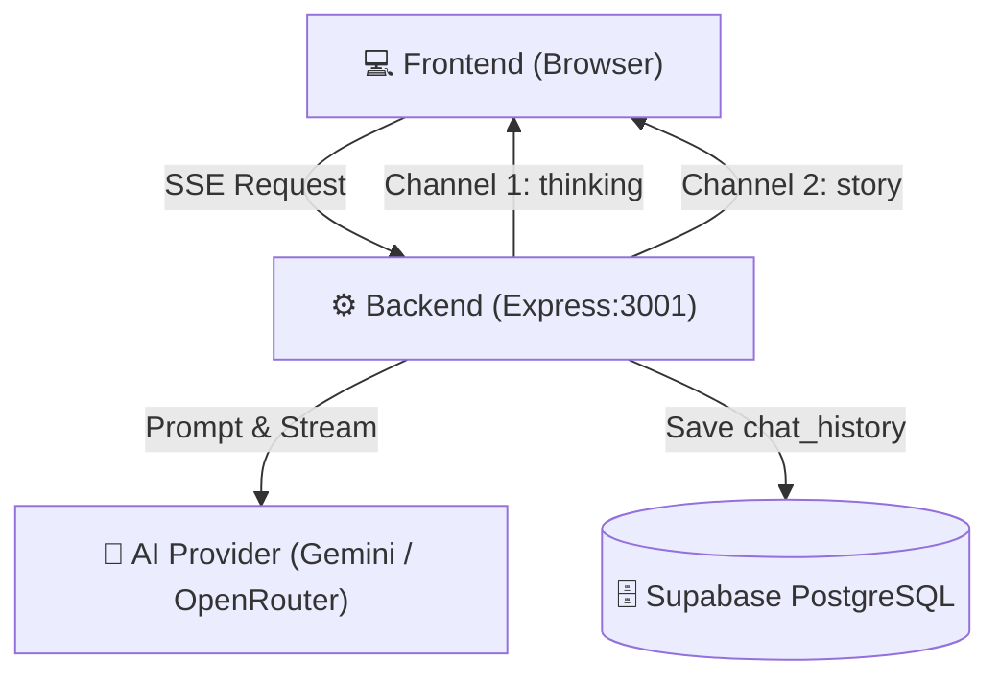

# 📖 Smart Novel AI Chat & Co-Writer

แอปพลิเคชันผู้ช่วยเขียนนิยายอัจฉริยะ (Smart Novel AI Chat & Co-Writer) พร้อมระบบสตรีมมิ่งกระบวนการคิดของ AI (`<thinking>...</thinking>`) แยกกล่องแบบเรียลไทม์ และระบบจัดเก็บประวัติการสนทนาด้วย Supabase Database

---

## 🌟 ฟีเจอร์เด่น (Key Features)

1. **Dual-Channel Real-time Streaming (SSE):** คัดแยกขั้นตอนความคิด (Thinking Process) ลงกล่องสีเทาเข้ม และส่งเนื้อหานิยายลงกล่องแชทหลักพร้อมกันแบบเรียลไทม์
2. **Supabase Database Integration:** จัดเก็บประวัติการคุยและการสร้างสรรค์นิยาย (`chat_history`) อย่างเป็นระบบ
3. **Local Fallback Protection:** หากยังไม่ได้เชื่อมต่อฐานข้อมูล Supabase ระบบจะสลับไปใช้ In-Memory / Local Fallback อัตโนมัติ โดยไม่ทำให้การทำงานสะดุด
4. **Multi-Model Support:** รองรับทั้ง Google Gemini (เช่น `gemini-3.8-flash`) และ OpenRouter
5. **ความปลอดภัยระดับสูง (Zero Secret Exposure & BYOK):**
   - **Server Proxy Mode:** คีย์ลับหลักของระบบ (เช่น Supabase Service Role Key และ Server API Key) จะถูกเก็บไว้ที่ฝั่ง Backend (`.env`) เท่านั้น ไม่ถูกเปิดเผยสู่หน้าเว็บสาธารณะ
   - **Bring Your Own Key (BYOK):** หากผู้ใช้ระบุ Gemini API Key ส่วนตัวผ่านเมนูตั้งค่า คีย์จะถูกเก็บไว้เฉพาะใน Local Storage ของเบราว์เซอร์ และส่งผ่าน Header `x-goog-api-key` ไปยัง Google Gemini API / Backend Proxy ผ่านช่องทาง HTTPS โดยไม่มีการบันทึกคีย์ส่วนตัวลงฐานข้อมูลส่วนกลาง

---

## 🏗️ สถาปัตยกรรมระบบ (Architecture)



---

## 🚀 วิธีการติดตั้งและเริ่มใช้งาน (Quick Start)

### 1. โคลนและติดตั้ง Dependencies

```bash
# ติดตั้ง dependencies ฝั่ง backend
cd backend
npm install
```

### 2. ตั้งค่าตัวแปรสภาพแวดล้อม (Environment Variables)

คัดลอกไฟล์ตัวอย่าง `.env.example` ไปเป็น `.env` ในโฟลเดอร์ `backend/`:

```bash
cp .env.example .env
```

แก้ไขไฟล์ `backend/.env` ใส่ค่าของคุณ:

```env
PORT=3001
SUPABASE_URL=https://your-project.supabase.co
SUPABASE_ANON_KEY=your_anon_key_here
SUPABASE_SERVICE_ROLE_KEY=your_service_role_key_here

AI_PROVIDER=gemini
DEFAULT_MODEL=gemini-3.1-flash-lite
GEMINI_API_KEY=your_gemini_api_key_here
OPENROUTER_API_KEY=your_openrouter_api_key_here
```

> **⚠️ ข้อควรระวังความปลอดภัย:**
> ไฟล์ `.env` มีการตั้งค่าใน `.gitignore` เรียบร้อยแล้ว **ห้าม** อัปโหลดไฟล์นี้ขึ้น Git หรือแชร์สู่สาธารณะโดยเด็ดขาด

### 3. รันเซิร์ฟเวอร์หลังบ้าน (Backend)

```bash
npm start
```

เซิร์ฟเวอร์จะเริ่มทำงานที่ `http://localhost:3001`

### 4. เปิดใช้งานหน้าเว็บ (Frontend)

สามารถเปิดเข้าใช้งานผ่าน `http://localhost:3001` ได้โดยตรง (เซิร์ฟเวอร์จะให้บริการไฟล์ Frontend จาก Root อัตโนมัติ)

---

## 🔒 มาตรการความปลอดภัย (Security Standards)

- **Ignored Secrets:** ไฟล์ `.env`, `node_modules/`, และ Log ต่างๆ ถูกบล็อกด้วย `.gitignore` ทั้งระดับ Root และ Backend
- **Environment Isolation:** แยกฝั่ง Frontend ที่เป็น Static Files และ Backend ที่จัดการสิทธิ์ Service Role ไว้อย่างชัดเจน

---

## 📄 ลิขสิทธิ์ (License)

MIT License
