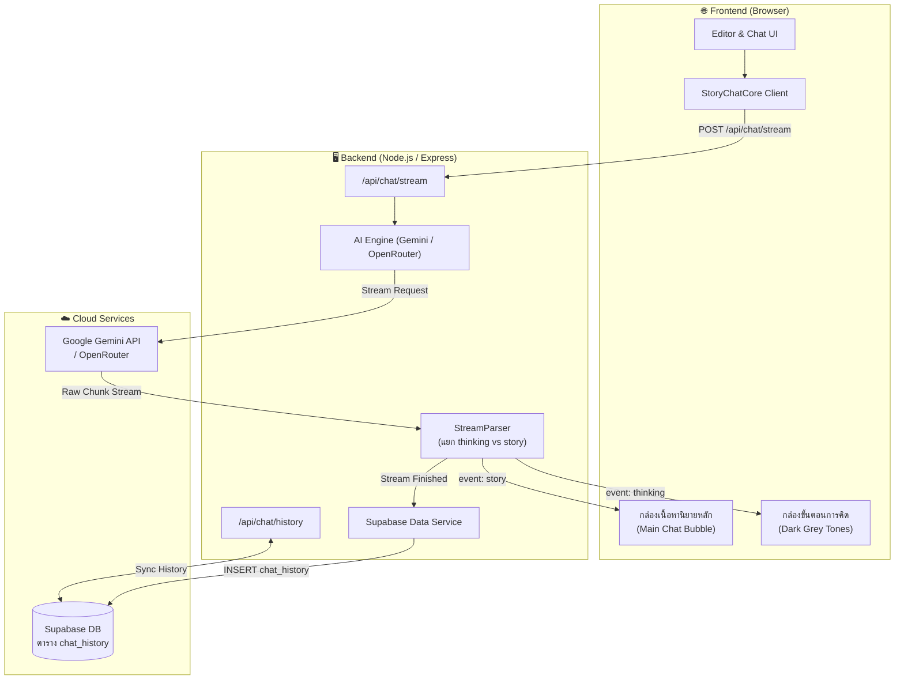
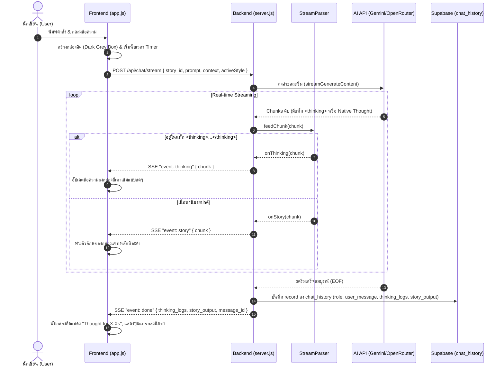

# 🏛️ พิมพ์เขียวสถาปัตยกรรมและการไหลของข้อมูล (System Architecture & Data Flow Blueprint)
## โครงการ: แอปนิยาย AI อัจฉริยะ (Decoupled Frontend-Backend Architecture)

---

### 1. ภาพรวมระบบ (Architecture Overview)

ระบบเดิมทำงานแบบ Client-Side Monolith โดยหน้าเว็บเรียกตรงไปยัง Google Gemini API จากเบราว์เซอร์ ซึ่งทำให้มีความเสี่ยงด้านความปลอดภัยของ API Key ไม่รองรับการเก็บประวัติลงฐานข้อมูลกลาง และไม่สามารถคัดแยกขั้นตอนความคิด (Thinking Process) ได้อย่างยืดหยุ่น

**ระบบใหม่** แยกสถาปัตยกรรมออกเป็น **Frontend (หน้าบ้าน)** และ **Backend (หลังบ้าน)** อย่างชัดเจน:

- **Frontend (ไคลเอนต์):** ให้บริการ UI สำหรับการเขียนนิยายและการสนทนา เชื่อมต่อกับ Backend ผ่าน **Server-Sent Events (SSE)** เพื่อรับสตรีมข้อมูลความคิด (Thinking Logs) และเนื้อหานิยาย (Story Output) แยกช่องสัญญาณกันแบบ Real-time
- **Backend (เซิร์ฟเวอร์ Node.js):** เป็นตัวกลางที่ปลอดภัย จัดการคีย์ API (Gemini / OpenRouter), ดักจับและแยกสตรีมความคิด (`<thinking>...</thinking>`), ส่งต่อสตรีมไปยัง Frontend และบันทึกข้อมูลลง **Supabase (`chat_history`)**
- **Database (Supabase PostgreSQL):** จัดเก็บประวัติการสนทนาอย่างละเอียด แยกเป็น `role`, `user_message`, `thinking_logs`, และ `story_output`



---

### 2. ลำดับขั้นตอนการไหลของข้อมูล (Detailed Data Flow Sequence)



---

### 3. โครงสร้างไฟล์โปรเจกต์ (Project Directory Structure)

```text
แอปแชท นิยาย/
├── backend/                              # ส่วนเซิร์ฟเวอร์หลังบ้าน
│   ├── .env                              # ไฟล์เก็บ Environment Variables & Keys
│   ├── .env.example                      # ตัวอย่างไฟล์ตั้งค่า
│   ├── package.json                      # การจัดการแพ็กเกจ (express, @supabase/supabase-js, cors, dotenv)
│   ├── src/
│   │   ├── server.js                     # จุดเริ่มต้น Express Server & Middleware
│   │   ├── config.js                     # โหลดและตรวจสอบค่า Config (.env)
│   │   ├── db/
│   │   │   ├── supabase.js               # Supabase Client & CRUD operations สำหรับ chat_history
│   │   │   └── schema.sql                # คำสั่ง DDL สร้างตาราง chat_history และ RLS
│   │   ├── ai/
│   │   │   ├── stream-parser.js          # Pure Parser แยกส่วน <thinking>...</thinking> และ story
│   │   │   ├── gemini-service.js         # ตัวเชื่อมต่อ Google Gemini API (Stream)
│   │   │   └── openrouter-service.js     # ตัวเชื่อมต่อ OpenRouter API (Stream)
│   │   └── routes/
│   │       ├── chat-routes.js            # Router จัดการ /api/chat/stream และ /api/chat/history
│   │       └── health-routes.js          # Endpoint ตรวจสอบสถานะการเชื่อมต่อ Supabase & AI
│   └── test/
│       ├── stream-parser.test.js         # Unit Test ทดสอบการตัดแยก Thinking Logs ในทุกเคส
│       └── supabase-db.test.js           # Unit Test ทดสอบการอ่าน-เขียนตาราง chat_history
├── docs/
│   ├── ARCHITECTURE.md                   # เอกสารพิมพ์เขียวนี้
│   └── superpowers/plans/                # บันทึกแผนการพัฒนา
├── index.html                            # โครงสร้างหน้าเว็บ Frontend
├── app.js                                # Frontend Controller (ปรับปรุงให้รองรับ SSE Stream)
├── app.css                               # สไตล์หลัก
├── style.css                             # สไตล์องค์ประกอบ Thought Line & Dark Grey Tones
├── story-chat-core.js                    # Pure Logic Module สำหรับบริหารบริบทเรื่องและนิยาย
└── test-core.js                          # Unit Test ของฝั่ง Frontend Core
```

---

### 4. โครงสร้างฐานข้อมูล Supabase (`chat_history`)

| คอลัมน์ | ประเภทข้อมูล | ค่าเริ่มต้น | รายละเอียด |
|---|---|---|---|
| `id` | `UUID` | `gen_random_uuid()` | รหัสประจำข้อความ (Primary Key) |
| `story_id` | `TEXT` | - | รหัสของนิยายที่ข้อความนี้สังกัดอยู่ (เช่น `story-123`) |
| `role` | `TEXT` | `'ai'` | บทบาทผู้ส่ง: `'user'`, `'ai'`, `'system'` |
| `user_message` | `TEXT` | `''` | ข้อความคำสั่งหรือสิ่งที่ผู้ใช้พิมพ์ส่งมา |
| `thinking_logs` | `TEXT` | `''` | รายละเอียดขั้นตอนการคิดของ AI ที่สกัดจาก `<thinking>` |
| `story_output` | `TEXT` | `''` | ผลลัพธ์เนื้อหานิยายที่พร้อมแทรกลงในเรื่อง |
| `model_name` | `TEXT` | `''` | ชื่อโมเดลที่ใช้งาน (เช่น `gemini-2.5-flash`) |
| `created_at` | `TIMESTAMPTZ` | `now()` | วันเวลาที่สร้างข้อความ |
| `updated_at` | `TIMESTAMPTZ` | `now()` | วันเวลาที่อัปเดตข้อความ |

#### คำสั่ง SQL สำหรับสร้างตาราง (DDL):
```sql
CREATE TABLE IF NOT EXISTS public.chat_history (
    id UUID PRIMARY KEY DEFAULT gen_random_uuid(),
    story_id TEXT NOT NULL,
    role TEXT NOT NULL CHECK (role IN ('user', 'ai', 'system')),
    user_message TEXT DEFAULT '',
    thinking_logs TEXT DEFAULT '',
    story_output TEXT DEFAULT '',
    model_name TEXT DEFAULT '',
    created_at TIMESTAMPTZ NOT NULL DEFAULT now(),
    updated_at TIMESTAMPTZ NOT NULL DEFAULT now()
);

-- สร้าง Index เพื่อให้การดึงประวัตินิยายตาม story_id รวดเร็ว
CREATE INDEX IF NOT EXISTS idx_chat_history_story_id_created 
ON public.chat_history (story_id, created_at ASC);

-- เปิดใช้งาน Row Level Security (RLS)
ALTER TABLE public.chat_history ENABLE ROW LEVEL SECURITY;

-- นโยบายสิทธิ์การเข้าถึงสำหรับ Service Role และ Public
CREATE POLICY "Allow select on chat_history" ON public.chat_history FOR SELECT USING (true);
CREATE POLICY "Allow insert on chat_history" ON public.chat_history FOR INSERT WITH CHECK (true);
CREATE POLICY "Allow delete on chat_history" ON public.chat_history FOR DELETE USING (true);
```

---

### 5. การจัดการสตรีมมิ่งความคิด (Thinking Process Extraction Mechanism)

1. **การดักจับแท็ก:** AI มักส่งข้อความที่มีโครงสร้าง:
   ```text
   <thinking>
   วิเคราะห์ตัวละครเร็น ตรวจสอบเหตุการณ์ล่าสุดใน Lorebook
   วางแนวทางการแต่งฉากต่อสู้
   </thinking>
   [STORY_START]
   สายลมกรดพัดผ่านซากปรักหักพังของนครไซออน...
   [STORY_END]
   ```
2. **อัลกอริทึม StreamParser:**
   - สถานะ `isThinking: false` (เริ่มต้น)
   - หากเจอ `<thinking>` หรือ `<think>`: สลับเข้าสู่โหมดคิด (`isThinking = true`) และส่งสัญญาณให้ Frontend เปิดกล่อง Dark Grey Tones
   - ขณะที่ `isThinking == true`: ข้อความทั้งหมดจะถูกส่งผ่านอีเวนต์ `event: thinking`
   - เมื่อเจอ `</thinking>` หรือ `</think>`: ปิดโหมดคิด (`isThinking = false`)
   - ข้อความหลังจากนั้นจะถูกส่งผ่านอีเวนต์ `event: story` ไปยังกล่องแชทหลัก
   - **รองรับการแยกข้าม Chunk (Cross-Chunk Boundary):** ตัวแยกมี Buffer พักข้อความสั้นๆ เมื่อเจออักขระเปิด `<` จนกว่าจะพิสูจน์ได้ว่าเป็นแท็กจริงหรือไม่ ป้องกันแท็กหลุดร่วงไปในข้อความ

3. **Frontend Presentation (Dark Grey Tones):**
   - ข้อความที่ได้จาก `event: thinking` จะอัปเดตลงใน Component `.thought-line` ทันที พร้อมเอฟเฟกต์ Shimmer และ Real-time Timer
   - เมื่อสตรีมเสร็จสิ้น กล่องจะสรุปเวลาเป็น `Thought for X.Xs` พร้อมปุ่มพับ-ขยาย
